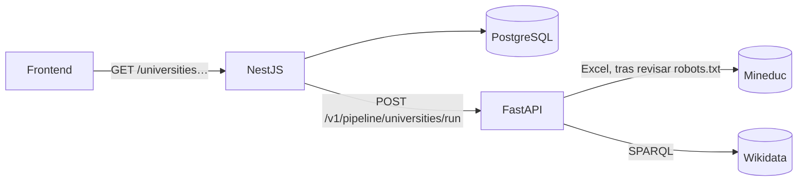

# Pipeline de datos de universidades

Cubre los requisitos 3 (recuperación y preparación), 4 (procesamiento en Python), 5 (persistencia e indexación)
y 6 (recuperación de información). Las fuentes están en `fuentes-de-datos.md` y las métricas en `evaluacion.md`.

## 1. Vista general

La arquitectura se mantiene: el frontend solo habla con NestJS; NestJS es el único que llama al servicio
Python y a la base de datos.



Una ingesta (`POST /universities/ingestion`, solo administradores, o programada) hace esto:

1. NestJS registra una ejecución `running` y llama a Python.
2. Python descarga, valida, limpia, deduplica y cruza; devuelve registros, procedencia y un informe de calidad.
3. NestJS verifica el contrato de la respuesta y, en **una transacción**, inserta o actualiza solo lo que cambió.
4. La ejecución se cierra como `succeeded`, `partial` o `failed`, con sus contadores.

## 2. Recuperación y preparación (requisito 3)

| Etapa | Qué hace | Dónde |
|---|---|---|
| Extracción | Lee la ficha para hallar la edición más reciente, descarga el Excel y consulta SPARQL | `pipeline/runner.py`, `catalog.py`, `wikidata.py` |
| Respeto de `robots.txt` | Consulta `robots.txt` por sitio antes de descargar páginas | `pipeline/robots.py` |
| Validación | Cada fila del Excel pasa por un modelo `pydantic`; las inválidas se **rechazan con su fila y motivo** | `catalog.py` |
| Limpieza | Espacios colapsados, nombres de `MAYÚSCULAS` a formato legible, estado a `snake_case` | `text.py` |
| Normalización | Clave de comparación sin tildes ni puntuación (`name_key`); tipo de institución a `category` y `ownership` | `text.py`, `catalog.py` |
| Deduplicación | Se descartan filas repetidas por número de registro o por `name_key`; en Wikidata se fusionan filas del mismo QID | `catalog.py`, `wikidata.py` |
| Cruce | Une universidades con entidades de Wikidata (ver sección 2.2) | `matching.py` |
| Trazabilidad | SHA-256 del archivo y de cada registro, URL, fecha de recuperación | `models.Provenance` |

### 2.1 Reglas de validación

| Dato | Regla | Si no se cumple |
|---|---|---|
| `NÚMERO REGISTRO` | `^[A-Z]\d{1,4}$` | Fila rechazada |
| Campos del Excel | No vacíos | Fila rechazada |
| `TIPO INSTITUCIÓN` | Uno de los seis conocidos | Fila rechazada (tipo desconocido) |
| Cabecera | Debe estar en las primeras 10 filas, sin importar tildes | Falla `invalid_format` |
| Sitio web (Wikidata) | `http(s)` con dominio; se pasa el host a minúsculas y se quita `/` final y fragmento | Se descarta y se avisa |
| Coordenadas | `Point(lon lat)` dentro de Chile (lat −90…−17, lon −110…−65) | Se descartan y se avisa (detecta ejes invertidos) |
| Año de fundación | Entre 1500 y el año actual | Se descarta y se avisa |
| Etiqueta de entidad | Debe existir y no ser el propio QID | Entidad descartada |

### 2.2 Cruce con Wikidata

Solo se enlazan **universidades** (no institutos ni CFT), **uno a uno**, y **nunca si hay ambigüedad**:

1. **Exacto:** mismo `name_key`.
2. **Prefijo:** el nombre de uno es prefijo del otro (mínimo 3 palabras) y hay un único candidato.
3. **Difuso:** similitud ≥ 0,90 y al menos 0,05 de ventaja sobre el segundo.

Dos entidades de Wikidata con el mismo nombre normalizado se ignoran. Cada enlace guarda su método y puntaje.
Se prefiere no enlazar a enlazar mal.

### 2.3 Qué pasa cuando algo falla

| Situación | Resultado | Datos guardados |
|---|---|---|
| La ficha no responde, no tiene el enlace o `robots.txt` no la permite | Se usa la URL configurada y se anota | Se actualizan |
| El Excel no se puede descargar (red, 5xx, `robots.txt`) y hay `MINEDUC_CATALOG_FILE` | Se usa el archivo local; su fecha es la de modificación del archivo | Se actualizan |
| El Excel no se puede obtener de ninguna forma | `failed` (Wikidata queda `skipped`) | **Intactos** |
| El Excel está corrupto o sin cabecera | `failed` (`invalid_format`) | **Intactos** |
| Wikidata no responde o devuelve basura | `partial`: se procesa el catálogo | El enriquecimiento anterior se **conserva** |
| Python no responde, tarda de más o devuelve algo inválido | Ejecución `failed` | **Intactos** |
| Hay otra ingesta en curso | `409`; una ejecución `running` de más de 10 min se cierra como fallida | — |

Reintentos: hasta 3 intentos con esperas de 1 s y 2 s; se respeta `Retry-After` (tope 30 s); un 4xx falla de
inmediato. Los reintentos solo ocurren ante red, 429 y 5xx.

## 3. Procesamiento en Python (requisito 4)

### 3.1 Endpoint

`POST /v1/pipeline/universities/run` (documentado en `/docs` de FastAPI).

Entrada:

```json
{ "sources": ["mineduc_ies", "wikidata"] }
```

`mineduc_ies` es obligatoria (es el catálogo base); se aceptan solo esos dos valores y se quitan duplicados.
Cualquier otra cosa devuelve `422`:

```json
{ "error": { "code": 422, "message": "Datos inválidos", "details": [ … ] } }
```

Salida (`PipelineResult`), resumida:

| Campo | Contenido |
|---|---|
| `status` | `succeeded`, `partial` o `failed` |
| `sources[]` | Por fuente: estado, URL, edición, fecha, huella, registros recibidos/válidos/rechazados, duplicados, ms, notas, error |
| `universities[]` | Registros limpios con `provenance[]` (fuente, id externo, URL, fecha, huella) y `match` si se cruzó |
| `rejected[]` | Filas rechazadas con fuente, número de fila y motivo |
| `quality` | Totales, `pct_valid`, `match_rate`, cobertura de sitio web y coordenadas, muestras sin cruzar |

Una fuente caída **no** es un error HTTP: la respuesta es `200` con `status: failed|partial`. Los errores HTTP
quedan para peticiones mal formadas (`422`) o fallas internas (`500` genérico, sin detalles).

### 3.2 Integración con NestJS

- `PythonService.runUniversitiesPipeline()` usa su **propio tiempo máximo** (`PYTHON_PIPELINE_TIMEOUT_MS`,
  120 s) porque el pipeline descarga fuentes externas; las llamadas rápidas siguen en 3 s.
- Errores traducidos: sin conexión `503`, tiempo agotado `504`, respuesta no exitosa o no JSON `502`.
- `isPipelineResult` valida la forma de la respuesta antes de persistir: no se confía a ciegas en el servicio.
- El contrato está protegido en ambos lados: `backend/test/fixtures/pipeline-result.json` lo genera el pipeline
  real (`python -m scripts.export_contract_fixture`) y **CI falla si el archivo queda desalineado**.

### 3.3 Pruebas

| Suite | Cantidad | Qué cubre |
|---|---|---|
| Python (`pytest`) | 80 | Limpieza de texto, parseo del Excel real, Wikidata, cruce, HTTP con reintentos, `robots.txt`, orquestador (todas las fallas), API |
| NestJS unitarias | 36 | Cliente Python, índice BM25, normalización, métricas, evaluación de búsqueda |
| NestJS e2e | 18 | Aplicación con base simulada |
| NestJS integración | 50 | PostgreSQL real: ingesta, idempotencia, cambios, desactivación, fallas, permisos, búsqueda, métricas |
| Frontend (`vitest`) | 71 | Cliente API, utilidades y pantalla Universidades |

Además se verificó de punta a punta (FastAPI y NestJS reales, fuentes locales, PostgreSQL): ingesta de 128
registros, segunda ejecución sin cambios, y los dos escenarios de falla (fuentes caídas y Python caído) conservando los datos.

## 4. Persistencia e indexación (requisito 5)

### 4.1 Tablas

| Tabla | Para qué |
|---|---|
| `universities` | Una fila por institución: datos del catálogo, enriquecimiento de Wikidata y frescura |
| `data_sources` | Fuentes conocidas con su licencia (sembradas por la migración) |
| `source_records` | Un registro por dato externo recibido: id externo, huella, URL, `payload` JSON original, fechas |
| `ingestion_runs` | Una fila por ejecución: estado, quién la lanzó, contadores, fuentes, calidad y rechazados |

### 4.2 Metadatos de procedencia y frescura

- `source_records`: `first_seen_at` (primera vez que se vio), `fetched_at` (última recuperación),
  `changed_at` (último cambio de contenido), `content_hash`, `url`, `last_run_id`.
- `universities`: `catalog_fetched_at`, `enriched_at` y `updated_at`. **`updated_at` solo cambia cuando cambia
  el contenido**, no en cada verificación.
- La API devuelve la procedencia de cada resultado y `GET /universities/:id` agrega licencia y huella.

### 4.3 Mecanismos anti-duplicados

| Nivel | Mecanismo |
|---|---|
| Pipeline | Descarta repetidos por número de registro y `name_key` |
| Base de datos | `UNIQUE` en `registry_number`, `name_key`, `wikidata_id` y `(source_code, external_id)` |
| Ingesta | Es un *upsert* por número de registro: repetir la ingesta no crea filas (`unchanged = 128`) |
| Cambios | Se compara la huella de cada registro: solo se escribe lo que cambió |
| Bajas | Lo que sale del catálogo se **desactiva** (`is_vigente = false`), no se borra |

### 4.4 Restricciones de calidad

La migración agrega `CHECK` de latitud, longitud, año de fundación (1500–2100) y estados de ejecución.

### 4.5 Relación entre datos externos y propios

- Cada `source_records` apunta a su `universities` (clave foránea, `ON DELETE SET NULL`).
- `users.university_origin` es texto libre. `GET /universities/resolve?name=…` lo vincula con el catálogo:
  coincidencia **exacta** (sin tildes ni mayúsculas) o un único candidato que **cubre todos los términos** y gana
  al segundo por un factor de 1,5. Ante la duda devuelve candidatos y `match: null`. Todavía no se guarda el
  vínculo en el perfil; el endpoint es la base para hacerlo.

### 4.6 Criterios de búsqueda

`GET /universities` (requiere sesión):

| Parámetro | Efecto |
|---|---|
| `q` | Texto (máx. 100); con texto se ordena por relevancia |
| `category` | `universidad`, `instituto_profesional`, `centro_formacion_tecnica` |
| `ownership` | `estatal`, `particular_con_aportes`, `privada`, `otra` |
| `includeInactive` | Incluye instituciones no vigentes (por defecto no) |
| `limit` (1–100, def. 20), `offset` | Paginación |

También: `GET /universities/sources` (frescura por fuente), `GET /universities/metrics` (requisito 7) y
`GET /universities/ingestion-runs` (administradores).

## 5. Recuperación de información (requisito 6)

| Elemento | Decisión |
|---|---|
| **Corpus** | Una entrada por institución del catálogo (128). Cada documento tiene tres campos: `name` (nombre oficial), `kind` (tipo, propiedad, estado y dominio del sitio web) y `alias` (siglas) |
| **Consulta** | `GET /universities?q=…`, con filtros opcionales |
| **Tokenización y normalización** | Minúsculas → sin tildes → separar por no alfanuméricos → quitar palabras vacías en español → singularización simple (`estatales→estatal`, `universidades→universidad`) |
| **Índice** | Índice invertido en memoria, reconstruido solo cuando cambian los datos (se compara cantidad y última modificación) |
| **Ranking** | Okapi BM25 (`k1=1,5`, `b=0,75`) con frecuencia ponderada por campo: `name` ×3, `kind` ×1, `alias` ×1. El último término también se busca como prefijo (con medio peso), útil mientras se escribe |
| **Resultados** | Ordenados por puntaje, con el puntaje y los metadatos: tipo, estado, sitio, coordenadas, fuentes y fechas |
| **Sinónimos** | El tipo se indexa también con sus siglas (`cft`, `ip`) y hay una tabla pequeña de siglas **curadas a mano** (USACH, PUCV, UAI…). No provienen de ninguna fuente; están en `search/aliases.ts` |

Limitación conocida: el catálogo no trae ubicación, así que «universidades en Valparaíso» solo encuentra las que
lo dicen en su nombre. Agregar región o comuna (por ejemplo, desde Wikidata) es el siguiente paso natural.
El corpus de textos (F3) no existe todavía; el buscador funciona con nombres, tipos y siglas.
